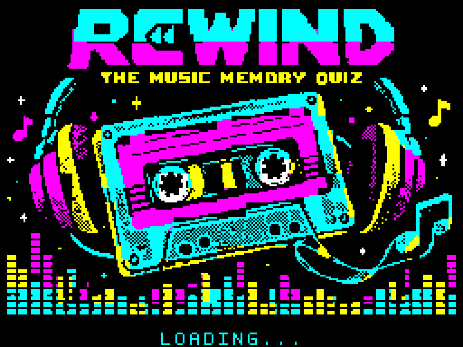
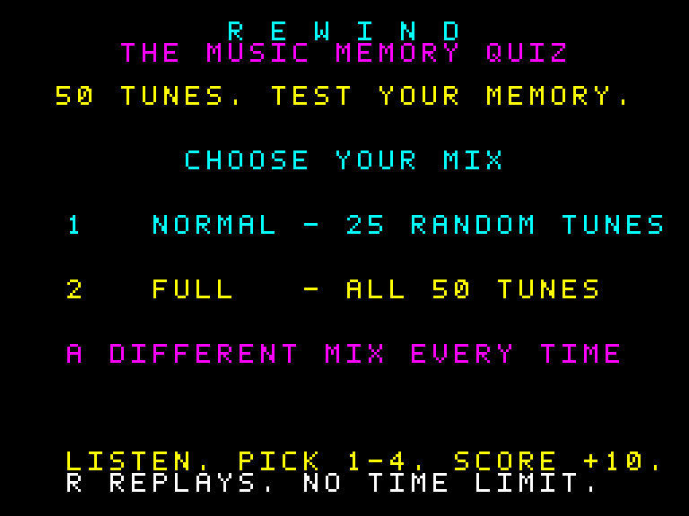
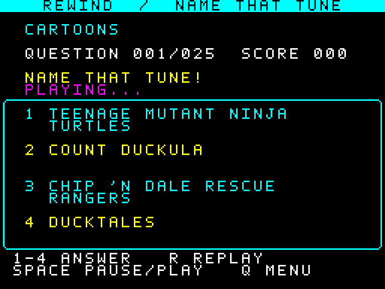
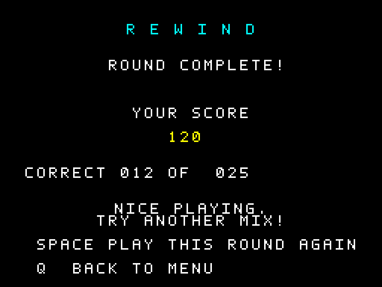

# REWIND — The Music Memory Quiz

A music trivia game for the **ZX Spectrum 128K PAL**, with 50 AY arrangements across ten categories. Listen to an excerpt and choose the matching title.

Developed with the assistance of **ChatGPT / OpenAI Codex**: game code, music conversion, graphics and testing were prepared iteratively with human selection and feedback.



## Game page

[Visit the REWIND game page](https://mmmpt.github.io/rewind-zx-spectrum/)

## Download and play

- [Download the TAP](downloads/Rewind_Quiz_128K.tap?raw=true)
- [Download the 128K SNA snapshot](downloads/Rewind_Quiz_128K.sna?raw=true)

Select a **ZX Spectrum 128K PAL** model in your emulator. Load the TAP with `LOAD ""`, or open the SNA snapshot directly. After the loading screen, press **Space** to open the menu.

| Mode | Round |
| --- | --- |
| 1 — Normal | 25 different songs selected at random from all 50 |
| 2 — Full | All 50 songs in a new shuffled order |

The menu is silent. Music plays in the quiz. There is no time limit.



## Controls

| Key | Action |
| --- | --- |
| 1–4 | Choose an answer |
| R | Replay the excerpt |
| Space | Pause/resume; continue after an answer |
| Q | Return to the menu |

A correct answer earns **10 points**: up to 250 in Normal mode and 500 in Full mode. On the results screen, Space starts another round in the same mode, with a fresh shuffle.



## Music and answers

Five excerpts in each category: Movies, Pop & Rock, Cartoons, TV Series, Electronic, Gothic, Metal, Video Games, Synth-pop and Dance.

The game has **250 answer titles**. Each question offers one correct title and three distinct alternatives from the same category. Wrong alternatives do not repeat during a round.

[Recorded song catalogue](source/songs_manifest.json) · [All answer titles](source/answers_catalogue.json)



## Build from source

Python 3.10+ is required. From the repository root:

```sh
python3 -m pip install -r requirements.txt
python3 source/build.py
python3 source/verify.py
python3 source/verify_rom.py
```

Build outputs are written to `source/`. The checked-in playable files are in `downloads/`. No network downloads are needed by the game build. The supplied raw AY streams contain the fifty selected arrangements.

See [technical build notes](source/BUILD.txt) for memory layout and compression. `source/preview.py` optionally records a native game-loop preview; it also requires ffmpeg.

## Validation

Tests cover all 50 AY streams byte for byte, both round lengths, shuffled unique questions, answer pools, wrapped text colours, scoring, pause/replay, keyboard input and a silent menu. The TAP was also loaded through a Spectrum 128K ROM using SkoolKit fast loading, and the SNA bank layout was checked.

Testing used emulation; physical Spectrum hardware and physical tape have not been tested. Audio in generated previews is an approximate AY simulation.

## Credits

Original songs, compositions, titles and associated properties belong to their respective owners. Source metadata for the arrangements is retained in `source/music/`. This is an unofficial hobby project and is not affiliated with the original artists, publishers or hardware manufacturers.
